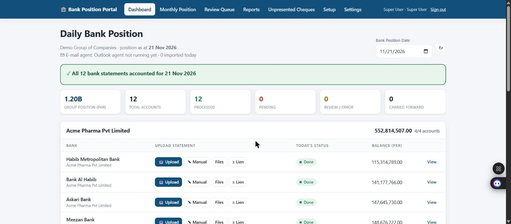

# Daily Bank Position Portal

Automated daily bank-position portal. Finance uploads each bank's statement against its
account tile; the system reads the file, finds the latest statement date, extracts the
closing balance for that date, posts it, and rolls up company + group totals.

Offline Node/Express + `node:sqlite`, plain HTML front-end. No internet required.



*The screenshot uses made-up demo data: invented companies and generated balances. All company names, account numbers and example keyword rules in this repository are placeholders. Replace them in **Setup** with your own.*

## Run (development)

```bash
npm install
npm start
```

Open http://localhost:4200 — default login **123 / 123**. **Change this password immediately in Settings, and never expose the portal to the internet with the default login.**

## Build the single .exe

```bash
npm run build
```

Produces `dist/BankPositionPortal.exe` plus loose `public/`, `data/`, `storage/` folders.

## How processing works

| Stage | Detail |
|---|---|
| Detect | file type by extension + magic bytes (real `.xlsx`, HTML-as-`.xls`, text PDF, image) |
| Parse | bank-specific format module (`parser/formats.js`) chosen from the account's bank `parser_key`, or auto-detected, else a generic grid reader |
| Extract balance | priority: (1) labelled **Closing/Ending Balance** → (2) running-balance **chain reconstruction** (unique terminal row) → (3) last row of the latest date → (4) `opening + credits − debits` cross-check |
| Verify | statement's bank / account number must match the tile it was uploaded against |
| Decide | confidence ≥ threshold (default 0.75) and no blocking warning → **posted**; otherwise → **Review Required** (never a silent post) |

Verified against real samples for **Habib Metropolitan Bank**, **Bank Al Habib**,
**Meezan Bank**, and **Askari Bank (NexCash)**. Password-protected PDFs prompt for a
password on upload (optionally stored, encrypted, per account).

## Layout

```
server.js            Express entry, session auth gate
db.js                schema + seed (companies/banks/accounts from the spec) + helpers
auth.js              login, lockout, role / section permissions
positions.js         daily-position resolution, off-day carry-forward, dashboard rollup
parser/
  index.js           orchestrator: detect → parse → decide → verify
  readers.js         xlsx (exceljs) / html-xls (cheerio) / pdf (pdfjs-dist, password aware)
  formats.js         HMB · BAHL · Meezan · Askari · generic parsers
  balance.js         priority engine + running-balance chain reconstruction
  normalize.js       amount / date parsing, column-synonym matching
routes/              config, upload, dashboard, admin (users/settings/review/corrections)
public/              login, dashboard, config, review, monthly, reports, settings
```

## Roles

- **Super User** — everything: setup, users, settings, parser config, corrections.
- **Finance User** — upload, process, review, view.
- **Viewer** — dashboards and reports only.

## Status

Phase 1 complete: setup screens, dashboard + upload, parser engine, daily position,
duplicate detection, review queue, audit log, carry-forward.
Phase 2 (next): monthly movement/consolidated reports & exports, off-day polish,
group drill-down. Phase 3: scanned-PDF OCR.


## Outlook agent (automatic e-mail pick-up)

`Install Outlook Agent.cmd` (double-click) registers a background task that reads the Outlook mailbox set in
`outlook-agent/config.json` (read-only), finds bank-statement e-mails and saves their attachments into `Inbox Drop/`.
The portal watches that folder, works out which bank account each file belongs to (account number, else bank +
company from the file / e-mail subject / file name) and posts the balances. Anything it cannot match with confidence
appears in the **Review Queue** ("Assign") — the account number is remembered so the next file matches by itself.
If the PC or portal was off, the next run catches up on every e-mail that arrived meanwhile.
**Fully automatic:** each agent run (every 10 min and at Windows sign-in) first checks the portal and, if it is not running, starts it hidden in the background (log: `outlook-agent/portal.log`); after saving new mails it calls a loopback-only `POST /api/agent/scan`, so balances are posted and the notification prepared immediately. Nobody has to open the portal or log in. This works while the PC is on and the Windows user is signed in (Outlook must be able to open).

`Remove Outlook Agent.cmd` stops it. Company short names used for matching are editable in Setup -> Companies.

### Duplicate statements
- Same file again (same bytes): not imported twice; a manual re-upload replaces the earlier copy.
- Same statement re-exported (different file, same balances): posts without any change.
- A different file giving a *different* balance for a day: if the earlier figure was the still-open last day of its
  statement it is updated by the newer file; if it was a closed day nothing is overwritten - the file goes to the
  Review Queue showing both numbers, and a person picks *keep what is on file* or *use this file*. Manual entries are never overwritten.

### "All statements received" e-mail
Settings -> E-mail notification. Off by default. When every active account has a confirmed balance for the previous working
day, one summary e-mail is prepared per day. The Outlook agent saves it as a draft (default) or sends it, per your choice.

## Available funds (group balance less reserves)
Settings -> *Funds & reserves*: a Super User creates **pools** and ticks which bank accounts belong to each (add / remove any time).
On the **Available Funds** page finance users add **reserve heads** (liens, returnable amounts, unpresented cheques ...) and set their
amounts (type `40000000`, `40,000,000` or `40m`). Amounts are dated: a day uses the latest value entered on or before it, and every
change is kept in a history. Result per pool and overall: *balance - reserves = available to use* (also shown as a tile on the dashboard).

### Funds statement equations
Settings -> *Funds statement - lines & equations*. Each line has a permanent code (A, B, C ...). Bank-balance lines come from pools,
reserve lines from reserve heads, and the admin adds **calculation lines** with equations, e.g. `A - RESERVES(A)` (funds available) and
`A + F` (overall balance). Functions: `RESERVES(A)` / `RESERVES()`, `BALANCES()`, `SUM(B:F)`, `MIN`, `MAX`, `ABS`. Equations are
checked live (unknown code, division by zero, circular reference are rejected); reserves added later are included automatically by
`RESERVES()`. Mark a calculation as a *headline* to show it on the dashboard and at the top of the Available Funds page.

### Liens / adjustments under a bank (nothing is created by default)
Setup -> Bank Accounts -> **Liens** (or the **± Lien** button on the dashboard): a Super User adds lines such as *Lien*, *RTGS in transit*,
*Clearing cheques* under any bank and chooses whether each is **deducted** from or **added** to that bank's balance. Finance users then
enter the amounts (dated). Dashboard, Monthly Position, Reports, PDF/CSV and the e-mail show the ledger balance, the adjustment lines and
**Net balance** per bank, plus net company and group totals. In the funds equations `LIENS(A)` is the total of the liens under the banks of pool A.

### Available Funds placement
The statement now sits **below the Monthly Position and Reports sheets** (no separate page); it follows the sheet's date, can be
exported to PDF/CSV, and is appended to the Monthly and Daily PDFs.

### E-mail contents
The "all statements received" message lists every bank (with liens and net), company and group totals, the available-funds statement,
and attaches the **Monthly Bank Position as a PDF** (created with the Edge browser that ships with Windows).
